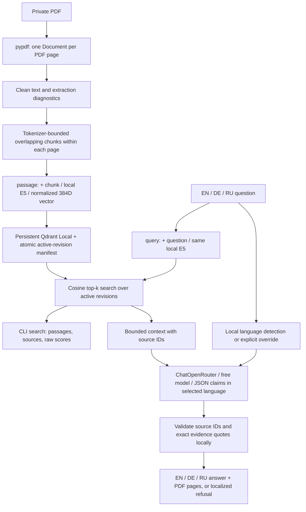

# GarageRAG

GarageRAG is a local-first retrieval-augmented generation (RAG) assistant for
automotive documentation. Ask in **English, German or Russian**, retrieve English
source passages locally, and receive an answer in your chosen language with
verbatim evidence and locally verified PDF page references.

Built as an open-source engineering portfolio project, it emphasizes explicit
pipeline stages, reproducible indexing, testable grounding and free-only remote
generation. It helps readers find information in an owner's manual; it does not
replace professional diagnosis or establish that a procedure applies to a car.

**Stack:** Python 3.12+, LangChain Core / ChatOpenRouter, Sentence Transformers
(`intfloat/multilingual-e5-small`), Qdrant Local, pypdf, Pydantic and Lingua.

**Current version: 0.2.0.** Features include page-aware ingestion, incremental
indexing and recovery, local semantic search, automatic EN/DE/RU answer language,
explicit language override, and generation with validated source IDs and quotes.
The original Phase 1 baseline is preserved as Git tag `v0.1.0`.

Phase 1 uses an **owner's manual**, not a workshop repair manual. The initial
document covers the **2002 BMW E39 525i, 530i and 540i** (186 PDF pages). Equipment,
body style and market qualifications in each passage still apply. Finding a
passage does not establish that it applies to every car in the document.

## Quick start on macOS (Apple Silicon)

Use native arm64 Python 3.12 or newer (3.12 is the CI baseline). No Qdrant server,
Docker, database account, or OpenRouter key is needed for indexing/search.

```bash
python3.12 -m venv .venv
source .venv/bin/activate
python -m pip install -e '.[dev]'
cp .env.example .env  # only when .env does not already exist
mkdir -p data/private
```

Download the manual yourself from the [source PDF](https://www.ge39.com/files/2002Manual-5ser.pdf)
or the [2002 5 Series archive](https://www.bmwsections.com/docs/5series/), and save it
as `data/private/bmw_e39_2002_manual.pdf`. The manual and its text are copyrighted
by BMW AG and are **not distributed with this project**. Check your permission
to use any document. Source files, extracted text, vectors, caches, and secrets
stay ignored by Git. The source URL is provenance, not an automatic downloader.

```bash
garage-rag index data/private/bmw_e39_2002_manual.pdf \
  --title 'BMW E39 2002 Owner Manual' --language en \
  --models 'BMW 525i,BMW 530i,BMW 540i' --kind owner_manual \
  --source-url https://www.ge39.com/files/2002Manual-5ser.pdf

# Re-run the identical command: no extraction or embedding work if unchanged.
garage-rag stats
garage-rag search 'How do I check the engine oil level?' --top-k 5
garage-rag search 'Wie prüfe ich den Motorölstand?' --top-k 5 --json
garage-rag search 'Как проверить уровень моторного масла?' --top-k 5
```

The first changed-document index/search downloads the pinned
`intfloat/multilingual-e5-small` snapshot from Hugging Face. Subsequent runs use
the cache. Set `HF_HUB_OFFLINE=1` after the download for strictly offline search.
CPU is the portable default on M1; use `--device mps` explicitly to try Metal.
Batch size 16 keeps memory modest on a 16 GB machine.

For generation only, set `OPENROUTER_API_KEY` in your local `.env` (never on the
command line), then run:

```bash
# Automatic answer language (default: --answer-language auto).
garage-rag ask 'How do I check the engine oil level?' --top-k 5
garage-rag ask 'Wie prüfe ich den Motorölstand?' --top-k 5
garage-rag ask 'Как проверить уровень моторного масла?' --top-k 5

# Explicit override: English question, German answer.
garage-rag ask 'How do I check the engine oil level?' --answer-language de

# An unsupported repair specification should produce a refusal.
garage-rag ask 'What is the cylinder head bolt tightening torque?'
```

The repair-specification question should be refused when the retrieved owner's
manual does not provide that repair specification. Automated refusal tests use
only our invented corpus; limited live observations are recorded separately below.

`OPENROUTER_MODEL` defaults to `openrouter/free`. Only that router or an explicit
`provider/model:free` identifier is accepted. Provider price caps are zero for
prompt, completion and request; provider fallback is disabled and no model
fallback list is sent. A free model may be unavailable or rate limited: the
program reports an error instead of switching to a paid model. SDK retries are
disabled; one command makes at most one completion request with a 60 s timeout.

Run `garage-rag --help` and `garage-rag <command> --help` for options. Put global
options before the command, for example:

```bash
garage-rag --index-dir data/qdrant-experiment --chunk-tokens 320 index path/to/manual.pdf
garage-rag --index-dir data/qdrant-experiment --chunk-tokens 320 search 'your question'
```

All index commands must use the same chunk configuration. To change the
embedding configuration or chunking, select a **new index directory**. Document
filenames are document identities and must be unique within an index. Index
another PDF with another `index` call to add it; changes replace that document's
active revision. Removing a file from disk does not remove it from the index.

## Answer languages

`ask --answer-language auto|en|de|ru` controls the answer; `auto` is the default.
Lingua runs locally over the question with only English, German and Russian as
candidates. Shared automotive names (BMW, DDE, ABS, Steptronic and others), units
and alphanumeric model identifiers are removed **only for language detection**.
Retrieval and generation receive the original question unchanged. No translation
request or additional LLM call is made.

A guess needs a confidence of at least 0.70 and a margin of at least 0.25 over the
runner-up; otherwise the answer language falls back to English. These scores are
relative to three candidates, not calibrated probabilities. For example,
`Reifendruck?` selects German, while `BMW DDE ABS` and ambiguous `Motor?` fall back
to English. Mixed-language questions, unknown jargon and unsupported languages
can be misclassified; use an explicit override when intent is unclear. The
thresholds are conservative heuristics, not an evaluated language benchmark.
The detector uses [Lingua's local confidence API](https://github.com/pemistahl/lingua-py#113-confidence-values);
its language models ship in the dependency wheel and need no runtime download.

The selected language is fixed in the system instruction. Each generated claim
must pass the same local language detector; ambiguous or wrong-language claims
cause a conservative refusal. This can reject a valid short or jargon-heavy
answer. Refusals are local EN/DE/RU strings, including when context is missing or
model output fails validation. CLI help, errors, diagnostic reason codes and the
`PDF page N` citation label remain English. `ask --json` includes the resolved
`language` alongside `supported`, `text` and `reason`.

Quotes stay in the original English regardless of answer language. The
`index --language en` option describes the **source document**, not the answer language.
Existing Phase 1 indexes remain compatible; no re-embedding is required.

## How the pipeline works



1. **Ingestion.** `pypdf` extracts all pages, including blank pages. Metadata
   retains filename, document/content hash, PDF page (one-based), PDF page label,
   title, language, vehicle models, document type and optional source URL. Page
   labels are separate from page positions: references always use **PDF page N**.
   Extraction errors fail the document instead of silently dropping pages.
2. **Cleaning.** Normalize Unicode/whitespace, remove control characters and
   conservative alphabetic line-break hyphenation. Repeated long margin lines
   are removed when present on most pages. Numbers and short headings are kept.
   Raw PDF geometry, tables and image content are not reconstructed.
3. **Chunking.** Use E5's own fast tokenizer and character offsets. Chunks never
   cross pages, overlap by up to 48 tokens, prefer nearby paragraph/sentence
   endings, and fit **384 tokens including `passage:` and special tokens**.
   Every chunk keeps its page, character offsets, ordinal and actual token count.
   Empty pages produce no chunks. Inputs exceeding E5's 512-token limit are
   rejected rather than silently truncated; questions are bounded too.
4. **Embeddings.** A small LangChain `Embeddings` adapter wraps Sentence
   Transformers. E5 requires English prefixes for all three question languages:
   `passage: ` for documents, `query: ` for questions. Vectors are normalized;
   Qdrant uses cosine similarity. The model snapshot, dimension, tokenizer,
   prefixes and pipeline configuration are fingerprinted in the index.
5. **Storage and recovery.** SHA-256 fingerprints cover document bytes and user
   metadata. Deterministic point IDs let a retry reuse already persisted batches.
   Only a fully written revision is activated by an atomic manifest replacement.
   Partial revisions remain invisible to search; the old complete revision
   remains active after an interrupted update. Superseded/partial points stay
   private on disk and are excluded from active counts. There is no automatic
   deletion or compaction in Phase 1. Qdrant Local allows one process per index.
6. **Retrieval.** Current `query_points` API returns top-k active passages with
   source metadata and raw cosine scores. Scores are similarity, **not answer
   probabilities**; E5 often has high scores even for weak matches. No arbitrary
   universal refusal threshold is treated as proof of relevance. Inspect results
   before tuning `--min-score` (default: no threshold).
7. **Generation.** Only the question and at most eight retrieved chunks fitting
   a 12,000-character JSON context budget go to OpenRouter, never the whole PDF.
   Text in sources is untrusted data, not instructions. The system prompt demands
   claims in the resolved language, matching model/variant qualifications, verbatim English
   evidence, and refusal when evidence is insufficient. JSON is validated with
   Pydantic; every claim needs a known source ID and a quote actually found in
   that sent chunk. References are rendered from local metadata, never from
   model-invented page numbers. Invalid JSON, unknown sources, missing evidence,
   wrong-language or ambiguous claims, or altered quotes yield a conservative refusal without
   an extra API repair request.

LangChain is used through its core `Document`, `Embeddings`, and message APIs and
the native `langchain-openrouter` integration. The umbrella package and a chain
framework are unnecessary for this small, explicit pipeline.

## Statistics and extraction diagnostics

`garage-rag index` prints JSON with timings, embedded/reused chunks and extraction
diagnostics; `garage-rag stats` reads persisted metadata without loading E5.
Stats include active documents/pages/chunks, model and pinned revision, vector
dimension, token limits, per-document processing times and document hashes.
Diagnostics list pages without text, empty chunks, short/low-text pages and
suspicious chunks (replacement glyphs, few letters, or very long unbroken text).
They report page/ordinal/reasons rather than copying private text into logs.
Empty pages and image-only content require human review; zero extracted chunks
fails indexing. Diagnostics are heuristics, not a completeness certificate.

## Recorded Phase 1 acceptance

The following measurements were recorded before the multilingual changes, on
2026-10-25 with Python 3.12 / macOS arm64 / CPU and the private 186-page BMW manual
(these are measurements, not source excerpts):

| Check | Observed result |
| --- | --- |
| Full index | 186 pages, 241 chunks, 384 dimensions; 22.91 s with cached weights |
| Identical index command | 0 new embeddings, 241 reused chunks; 0.007 s |
| Extraction diagnostics | No empty pages/chunks; 4 low-letter-ratio chunks flagged |
| Russian oil-level search | PDF page 140 ranked first, cosine 0.8066 |
| Real free OpenRouter generation | Russian oil-check answer, five claims with validated page-140 evidence |
| Unsupported cylinder-head torque question | Real model abstained: insufficient evidence |
| Offline retrieval, API key unset | Tire/coolant searches completed with cached E5 |

The short tire-pressure query did not retrieve the expected detailed pressure
page in top-5; the coolant question retrieved page 142 at rank 3. This is a known
retrieval limitation, not hidden by the successful oil example. Try precise
wording and inspect a larger `--top-k`; a reviewed recall evaluation and possible
reranking belong in a later phase. A correct refusal in one live example is not
a guarantee of hallucination-free behavior. Free-router model selection and
availability change; reruns can differ. GitHub-hosted CI was not run in this
local session.

## Tests and CI

```bash
python -m pytest
ruff check .
```

Tests generate a PDF locally from the original, fictional
[`tests/fixtures/corpus.json`](tests/fixtures/corpus.json). They cover extraction,
page metadata, cleaning, token boundaries/overlap, diagnostics, real persistent
Qdrant retrieval, idempotency, interrupted-index recovery, configuration
isolation, bounded context, citation validation, refusal and sanitized failures.
Multilingual coverage includes short technical questions, automatic detection and
English fallback, all nine question/answer language combinations, CLI overrides,
localized refusals, verbatim English evidence in EN/DE/RU answers, unknown source
IDs, fabricated pages, translated/altered quotes and wrong-language claims.
Small deterministic embeddings and a local tokenizer keep CI independent of
Hugging Face downloads, BMW material and real API calls. These tests verify the
pipeline's contracts, not the quality of E5's real multilingual ranking or a
remote model's reasoning. GitHub Actions runs the same checks on Python 3.12.

## Multilingual verification (2026-10-25)

Local checks on Python 3.12 / macOS arm64:

| Check | Result |
| --- | --- |
| Offline automated suite | 93 tests passed; no OpenRouter requests or model downloads |
| Ruff | Passed |
| Editable installation and `pip check` | Passed |
| Isolated sdist and wheel build | Passed; archives contain no private data or credentials |
| TOML and CI YAML parsing; CLI help | Passed |
| Existing Phase 1 index | Opened unchanged: 186 pages, 241 chunks, 384 dimensions |

**Live API checks are separate from automated coverage.** Ten completion
requests were attempted against the private BMW index, with cached local E5 and
only zero-price OpenRouter routes. No paid fallback or automatic retry was used.

| Live check | Observation |
| --- | --- |
| Oil-level question, auto EN/DE/RU, `openrouter/free` | All three outputs were rejected by local validation; localized refusals were returned |
| Unsupported cylinder-head torque, auto EN/DE/RU, `openrouter/free` | Model returned insufficient evidence in all three cases; localized refusals passed |
| One additional English diagnostic request | Router selected `recursive/flint-v1.0:free`; empty content, `finish_reason=length`, 1,800 output-token limit reached |
| Oil-level question, EN/DE/RU, explicit `google/gemma-4-31b-it:free` | All three requests returned HTTP 429; sanitized errors, no fallback |

**Successful supported answers in all three languages were not demonstrated by
live API calls in this session.** They are verified with controlled offline
model replies, including real local Qdrant retrieval through the CLI. This is
not evidence of remote-model multilingual quality. The diagnostic request
demonstrates one cause of rejection; it does not establish the cause of every
earlier rejected response.

The free router can select reasoning models that exhaust the shared
reasoning/output token budget before emitting JSON. GarageRAG retains its
bounded generation budget and refuses empty or invalid output. See
[OpenRouter's reasoning-token budget documentation](https://openrouter.ai/docs/guides/best-practices/reasoning-tokens#reasoning-tokens-and-max_tokens).
When a free model is available, choose it explicitly with `--model` or
`OPENROUTER_MODEL`; rate limits still apply. Private response captures are not
included in the repository. GitHub-hosted Actions and MPS were not run during
this update.

## Privacy, publication and limitations

- This repository distributes code and our synthetic corpus under MIT. That
  license does **not** cover third-party documents or model weights. E5's model
  card declares MIT; check each downloaded model/source separately.
- `.env`, `data/private/`, `data/qdrant/`, `.cache/`, PDF/model/database files are
  ignored, as are all files under `data/`, `output/` and `outputs/`. Custom index
  directories contain document text too: keep them out of Git. Before publication inspect `git status` and `git ls-files`; `.gitignore`
  cannot remove an already tracked secret or copyrighted file.
- `search` intentionally prints private excerpts to your terminal; do not commit
  terminal captures, exported search JSON or generated answers. No automatic
  content logs, tracing, telemetry or index exports are configured. The CLI
  disables LangSmith tracing. Hugging Face downloads are network activity;
  embedding/document processing itself runs locally.
- `ask` transmits selected excerpts and your question to OpenRouter/providers.
  Free providers have their own retention policies. Do not use sensitive material
  without permission. Credentials and raw provider exceptions are never printed.
- Exact-quote and source validation prevent fabricated references. They **cannot
  prove that a claim in any language logically follows from a real English quote**.
  A model can still misinterpret evidence or fail to abstain. Inspect evidence;
  the system is not an authority for repairs or safety-critical decisions.
- No OCR, table/layout reconstruction, figure interpretation, repair-recipe
  inference, reranker, hybrid search, conversation memory, LangGraph, MCP,
  multi-agent architecture, web UI, Docker, or production concurrency.
- Chunk boundaries can split tables, procedures and cross-page explanations.
  Retrieval can miss answers. An absence in top-k is not proof of absence from
  the complete document. Adding vehicle models or further languages needs
  corpus-specific review.
- Versions are pinned for tested direct dependencies; this is not a full
  cross-platform transitive lockfile. CPU and MPS numerical results can differ
  slightly. Qdrant Local suits a small personal corpus, not a multi-user service.

## Roadmap (not implemented)

- **Retrieval evaluation:** reviewed multilingual question/evidence sets, recall@k
  and abstention metrics.
- **Hybrid search and embedding benchmarks:** compare dense models, lexical
  retrieval and optional reranking against measured baselines.
- **LangGraph orchestration:** consider explicit state and branching when a
  measured workflow needs them.
- **API and Web UI:** expose the validated pipeline with clear privacy controls.
- **Deployment and observability:** packaging, operational metrics and safe
  diagnostics without exporting private document contents by default.

These are future directions, not features of this release. Retrieval evaluation
and LangGraph implementation have not started.

## Publishing to GitHub

No GitHub repository URL is assumed. With GitHub CLI installed and authenticated,
replace `OWNER` with your account or organization and run these commands only
when you intend to publish this reviewed checkout:

```bash
git status --short
git ls-files  # inspect the public file list before uploading
gh repo create OWNER/garage-rag --public --source=. --remote=origin \
  --description 'Local-first multilingual RAG for automotive manuals with verified citations'
git push -u origin main
git push origin v0.1.0
```

If the intended repository already exists, use
`git remote add origin https://github.com/OWNER/garage-rag.git` instead of
`gh repo create`. Check `git remote -v` before pushing. Never force-push or upload
BMW PDFs, extracted passages, `.env`, embeddings, index files or answer captures.
Build artifacts use an explicit public-file allowlist for source distributions.
The MIT license covers this project's own code and synthetic test materials,
not BMW's manual or other third-party material.

## What to study before Phase 2

Understand page-level provenance and extraction loss; tokenizer limits and
overlap tradeoffs; E5 prefixes, normalization and cosine ranking; index
fingerprints and crash recovery; recall@k on a multilingual question set;
grounding versus citation validity; abstention precision/recall; context budgets,
prompt injection and provider costs. Build a small reviewed question/evidence
set before choosing a reranker, hybrid search or more orchestration.

## API references

- [LangChain ChatOpenRouter](https://docs.langchain.com/oss/python/integrations/chat/openrouter)
- [E5 model card](https://huggingface.co/intfloat/multilingual-e5-small)
- [Qdrant Python client and local mode](https://github.com/qdrant/qdrant-client)
- [OpenRouter provider pricing caps](https://openrouter.ai/docs/guides/routing/provider-selection#max-price)
