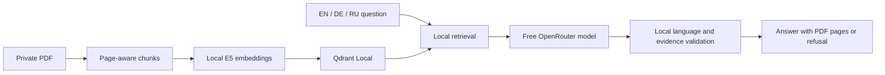

# GarageRAG

[](https://github.com/cryptoadya/garage-rag/actions/workflows/ci.yml)

A local-first RAG assistant for automotive documentation. Ask in **English,
German or Russian**, retrieve English source passages locally, and receive an
answer with verbatim evidence and locally verified PDF page references.

GarageRAG is a working CLI prototype for finding information in an owner's
manual. It does not replace professional diagnosis or repair instructions.

## Features

- Page-aware PDF extraction and overlapping, tokenizer-bounded chunks.
- Local multilingual semantic search with persistent, resumable indexing.
- EN/DE/RU answers, automatic language selection and an explicit override.
- Free-only OpenRouter generation with validated source IDs and evidence quotes.
- Localized refusals when context is missing or generated output fails validation.

**Stack:** Python 3.12+, LangChain Core / ChatOpenRouter, Sentence Transformers
(`intfloat/multilingual-e5-small`), Qdrant Local, pypdf, Pydantic and Lingua.
No Qdrant server or OpenRouter account is required for indexing and search.

## Quick start

Developed on macOS Apple Silicon with Python 3.12; CPU is the default device.

```bash
git clone https://github.com/cryptoadya/garage-rag.git
cd garage-rag
python3.12 -m venv .venv
source .venv/bin/activate
python -m pip install -e .
test -f .env || cp .env.example .env
mkdir -p data/private
```

Supply an English text-based PDF that you have permission to use. The initial
corpus was the [2002 BMW 5 Series owner's manual](https://www.ge39.com/files/2002Manual-5ser.pdf)
for the E39 525i, 530i and 540i. Save your own copy as
`data/private/bmw_e39_2002_manual.pdf`; **the manual is not distributed here**.

```bash
garage-rag index data/private/bmw_e39_2002_manual.pdf \
  --title 'BMW E39 2002 Owner Manual' --language en \
  --models 'BMW 525i,BMW 530i,BMW 540i' --kind owner_manual \
  --source-url https://www.ge39.com/files/2002Manual-5ser.pdf

garage-rag stats
garage-rag search 'How do I check the engine oil level?' --top-k 5
```

The first embedding operation downloads the pinned E5 model from Hugging Face.
After caching it, set `HF_HUB_OFFLINE=1` for offline retrieval. Repeating an
unchanged index command reuses the existing revision.

For answers, set `OPENROUTER_API_KEY` in your local `.env`, then run:

```bash
garage-rag ask 'How do I check the engine oil level?'
garage-rag ask 'Wie prüfe ich den Motorölstand?'
garage-rag ask 'Как проверить уровень моторного масла?'

# English question, German answer.
garage-rag ask 'How do I check the engine oil level?' --answer-language de
```

`--answer-language auto|en|de|ru` defaults to the question's detected language,
with English as the fallback. Evidence quotes remain in the source's English.
Only `openrouter/free` or an explicit `provider/model:free` is accepted; price
caps are zero, and there are no automatic retries or paid fallbacks. Free models
can be unavailable or rate limited. `ask` sends your question and selected
passages to OpenRouter/providers; indexing and retrieval stay local.

See the [usage guide](docs/usage.md) for configuration, index management,
troubleshooting and privacy precautions.

## Architecture



Source IDs refer only to passages actually sent to the model. Pydantic validates
the response; local checks reject unknown IDs and quotes absent from the cited
passage. Page references come from local metadata. **Valid citations do not
prove that a claim correctly interprets its evidence.** See the
[architecture guide](docs/architecture.md) for the pipeline and trust boundaries.

## Tests and status

The suite contains **130 offline test cases**. [CI](https://github.com/cryptoadya/garage-rag/actions/workflows/ci.yml)
runs pytest and Ruff on Python 3.12 using an original synthetic corpus, without
BMW material, model downloads or live API calls. Limited live smoke checks have
also produced validated EN/DE/RU answers; these are not quality benchmarks.

For development, install `python -m pip install -e '.[dev]'`, then run:

```bash
python -m pytest
ruff check .
```

[Test coverage, manual checks and reporting guidance](docs/testing.md) explain
what these checks establish and how to reproduce them.

## Limits and licensing

- Text extraction has no OCR, table/layout reconstruction or figure understanding.
- Retrieval can miss relevant passages; similarity scores are not confidence.
  Model, market, body-style and equipment qualifications must still be checked.
- Language detection and generation are heuristic. Valid answers may be rejected;
  models can misinterpret evidence. Inspect the sources before acting.
- Qdrant Local permits one process per index. No API, Web UI, hybrid search,
  reranker, LangGraph, agents, MCP or Docker integration is implemented.
- Keep `.env`, PDFs, extracted text, vectors, indexes and answer captures private.
  Custom index directories also contain source text; `.gitignore` does not
  protect files already tracked by Git.

[MIT](LICENSE) covers this project's own code and synthetic test materials.
BMW manuals are copyrighted by BMW AG and are not redistributed. Third-party
source documents and model weights have their own licenses.

## Roadmap and documentation

[Retrieval evaluation](docs/benchmarks/retrieval-evaluation.md) now provides an
offline EN/DE/RU baseline with agent-verified PDF page references and a
[results report](docs/benchmarks/phase2a-report.md).

Future directions: hybrid search and embedding benchmarks,
LangGraph orchestration, an API and Web UI, deployment and observability.
These are planned directions, not current features.

- [Usage and configuration](docs/usage.md)
- [Architecture and safety boundaries](docs/architecture.md)
- [Testing and result reporting](docs/testing.md)
- [Changelog](CHANGELOG.md)
