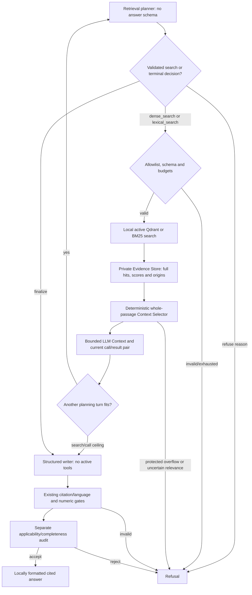

# Architecture and safety boundaries

GarageRAG separates local ingestion/retrieval from remote answer generation.
The implementation lives in [`src/garage_rag`](../src/garage_rag):

| Modules | Responsibility |
| --- | --- |
| `ingestion`, `embeddings`, `config`, `profiles` | Page extraction, token bounds and pinned model settings |
| `index`, `retrieval` | Persistent dense search; agentic/offline BM25, offline fusion and reranking |
| `generation`, `language`, `groq` | Context, schemas, language selection and provider transport |
| `workflow`, `agentic`, `agentic_context`, `local_tools`, `grounding`, `telemetry` | Bounded LangGraph, evidence storage/selection, local numeric gate, audit and safe observations |
| `evaluation`, `optimization` | Frozen retrieval evaluation and profile comparisons |
| `answer_evaluation`, `source_evaluation`, `review_packet` | Paired answer evaluation and private hash-bound review |
| `cli` | `index`, `stats`, `search` and `ask` commands |

## Extraction and indexing

`pypdf` extracts every PDF page, including blank pages. Metadata retains filename,
content/document hashes, one-based PDF position, page label, title, source language,
vehicle models, document type and optional source URL. Citations always use physical
**PDF page N**, not a printed label. Extraction errors fail the document.

Cleanup normalizes Unicode/whitespace, removes control characters, conservative
alphabetic line-break hyphenation and repeated long margin lines. Chunking stays
within each page, prefers sentence/paragraph boundaries and uses tokenizer offsets.
Defaults are 384 tokens with up to 48 overlapping tokens, including prefix/special-token
allowance. Empty pages create no chunks; a wholly textless document fails indexing.
No OCR, geometry, figure or table reconstruction occurs. Chunk boundaries can split
procedures and qualifications.

Sentence Transformers loads revision-pinned models with remote code disabled.
E5 Small uses normalized 384-dimensional vectors and `query: ` / `passage: `
prefixes for every language. E5 Base uses 768 dimensions; BGE-M3 uses 1024-dimensional
dense vectors without E5 prefixes. All profiles retain the application's 512-token
input bound and separate indexes. See [profile configuration](usage.md#embedding-profiles).

Qdrant Local stores cosine vectors. Model/revision, prefixes, chunking and relevant
library versions form a configuration fingerprint. Document bytes and supplied
metadata determine revision identity; filenames must be unique within an index.
Deterministic point IDs reuse completed batches after interruption. An atomic
manifest replacement activates a revision only when every batch is written.
Search sees active revisions only; failed updates leave the last complete revision
available. Superseded/partial points remain private on disk; no compaction exists.

`Index.search` performs dense `query_points` retrieval. Scores are similarities,
not relevance probabilities. Qdrant Local permits one process per directory.
The offline comparison adapters add active-only BM25, deterministic reciprocal-rank
fusion and optional top-20 cross-encoder reranking without changing CLI search.

## Direct and grounded answers

Both modes use the original query, initial dense ranking, context builder,
generation prompt and local validator. Local Lingua detection selects EN/DE/RU;
explicit `--answer-language` overrides it. Evidence stays in the source language.

Context contains at most eight whole passages within a 12,000-character JSON
budget. Every source ID maps to exactly the text sent. Pydantic requires strict
JSON, at most six claims and evidence per claim. Local checks reject unknown IDs,
quotes absent after whitespace normalization, translated evidence, wrong-language
claims, bracketed references and truncated output. PDF citations come from local
metadata. Direct mode finishes after these checks, without semantic auditing.

Grounded mode applies a numeric gate and a separate completion auditing every
claim's entailment, applicability, essential conditions, numerical relationships,
conflicts and whole-question completeness. Unique, complete claim coverage and
all checks true are required. Malformed or inconsistent audits refuse; no repair
completion occurs. An auditor cannot override a failed local check.

Only a draft's `insufficient_evidence` or an audit's `insufficient` verdict can
trigger one expansion. It uses the unchanged question and score filter at top-20,
retains every previously sent passage and fills remaining space with novel passages.
Compact JSON omits display URLs and redundant page labels, while retaining full
passage text and applicability metadata. Local citation metadata is unchanged.
IDs are rebuilt for the new context. If nothing new fits, return `no_new_context`
without another completion. Initial `--top-k 20` disables expansion.

The graph is sequential typed state with conditional edges, a fresh instance per
command and no planner, query rewriting, tools, conversation memory, checkpointer
or remote graph service. Evaluation checkpoints are separate from graph state.

## Agentic retrieval (Phase 4A)

`ask --workflow agentic` is a separate LangGraph; `direct`, `grounded`, their
prompts, limits and frozen evaluation datasets/metrics remain unchanged.

Groq planner turns use a single strict structured JSON decision schema, with no
native tools in those requests. `action` selects search/finalize/refuse; required
nullable method/query/top_k/reason fields are checked locally for compatibility.
Local search execution still uses the closed dense/BM25 allowlist and budgets.
The optional non-Groq backend retains its serial native protocol. No protocol
switch occurs as a fallback after errors. Terminal decisions require no search.
The initial empty context is not grounds to declare documentation out of scope.
Malformed controls and invented function names refuse without repair or retry.
`finalize` without evidence refuses without spending writer/audit calls.

The model still chooses tools and rewrites queries from returned evidence; no
translation dictionary or fixed search order is prescribed. A separate writer
receives fresh answer instructions and **no active tools**, with the last validated
local assistant/tool correlation pair containing the complete selected evidence.
For Groq this pair is generated locally after validated JSON search; planner
history serializes it as ordinary assistant/user JSON, without provider tools. The original
`tool_call_id` is returned even when the search/call cap routes directly to writing.
Earlier planning prompts and control replies are omitted from the writer, reducing
format ambiguity and token overhead. The writer's JSON passes the existing local
gates and mandatory audit. No additional search follows a failed final audit.

`local_tools` defines the closed function schemas: `dense_search` and
`lexical_search`, each taking only a 1–500-character nonblank query and integer
`top_k` 1–5. The CLI's `--top-k` further caps each call. Dense delegates to
`Index.search`; BM25 reuses `Retriever` over active Qdrant generations. Each tool
executes exactly one search. In the retained native backend the terminal actions are
`finalize` and
`refuse`, are local graph transitions and consume no search slot. Their strict
schemas reject extra arguments and unknown refusal reasons; they cannot return
an answer or bypass the writer/audit. They are consumed locally and never replace
the writer's last search/result pair. With `--min-score`, only dense search
plus both terminal actions are exposed so the cosine threshold cannot be silently
discarded. No model-supplied filters, paths,
URLs, executable names, function registries or remote tools are accepted.

The non-Groq backend round-trips native call IDs; Groq uses local correlation IDs.
In both paths,
malformed/unknown/batched calls, duplicate IDs and repeated tool/query/top-k tuples
stop before execution. Four searches of five hits bound the per-run store to
20 results before deduplication. There is no checkpoint, persistent agent memory
or agent-controlled filesystem mutation.

### Agentic context management

`agentic_context` separates three objects; Direct/Grounded still use the unchanged
`generation.build_context` (8 passages / 12,000 serialized characters).

1. **Evidence Store** owns full snapshots of every successful search: query,
   method, top-k, rank, raw score, text and original metadata/document ID. Exact
   text **and all metadata** identify duplicates, so revisions and different
   applicability remain distinct. Every occurrence retains its search/rank origin.
   Stable discovery-order `S1…S20` IDs are never reassigned after exclusion or re-entry.
2. **Context Selector** reconsiders the entire store after every search, independently
   of the preceding selected context. General request/document words and vehicle
   qualifiers from metadata do not establish a procedure topic. Compound topics
   need at least two focus terms within a 160-character window; single-term topics
   need that term. EN/DE/RU queries can supply source-language anchors. Retrieval
   rank breaks ties, rather than automatically protecting each first hit. With no
   usable topic/navigation anchor, semantic leads remain protected as unassessed.
   Structural page-reference lists are navigation, never sufficient answer evidence.
   All topical substantive passages remain protected, including conflicting sources.
   Conditions stay inside intact passages, attach to retrieved chunks on the same
   procedure page, or follow explicit `procedure_id` / `section_id` / `applies_to`
   links within a document revision. There is no blanket adjacent-page protection.
   Bare `if/not/only/before/after` do not globally protect unrelated prose. Explicit
   warning/applicability markers with unknown scope, safety/layout metadata and
   suspect extraction remain protected. Excluding a warning by `applies_to` requires
   complete explicit scope information for the primary procedures in that revision;
   missing/malformed scope, cross-revision matches or `global_warning` do not prove
   irrelevance. These optional metadata fields are not inferred by ingestion.
   All protected passages must fit **together**; otherwise `context_budget_exhausted`
   stops before planner/writer delivery, with no partial candidate context. This
   preserves both positive and negative topical results without deciding which
   source is correct. With no topical anchors and overflow, selection stops with
   `context_relevance_uncertain` instead of guessing across languages/paraphrases.
3. **LLM Context** contains at most 20 whole passages / 12,000 serialized characters.
   Protected evidence fits first. Useful navigation is optional, ranked by question
   focus, source-language focus and reciprocal retrieval rank (`1/(60+rank)`).
   Repeated navigation targets within a document revision are deduplicated; printed
   reference labels remain opaque, never assumed equal to PDF page numbers. Off-topic
   prose is excluded even when it would fit. Raw dense/BM25 scores are never compared.
   Discovery order keeps displayed IDs stable after selection. Text is never cut or
   summarized. All applicability and unknown metadata travel with selected text.
   The wire omits the display URL, duplicate page label and known index bookkeeping
   (`document_id`, `content_sha256`, `chunk_index`, `char_start`, `char_end`, `tokens`).
   Revision matching, dependency links and local citations use the full original
   metadata, including the omitted revision hash.
   Original documents, URLs and pages remain in the local source map.

Planner history retains the question, latest correlated search/result pair, and a
bounded query/ID history. Earlier copies of source text are replaced, not appended.
The writer receives the same final selected context and the current pair; existing
citation/language/numeric checks and auditor logic are unchanged. A source remaining
only in the store is unavailable for citation. `new_sources` counts newly selected
IDs, so eviction cannot produce a negative count.
`has_substantive_evidence=false` prevents a navigation-only finalize/search ceiling
from invoking writer/auditor and returns `insufficient_evidence`. This flag only
detects the absence of substantive candidates; true does not certify sufficient
evidence, applicability or safety. Existing local gates and mandatory audit still run.

`context_selections` reports cumulative found/stored/duplicate counts, selected and
excluded counts/IDs, protection and exclusion reasons, blocked IDs, serialized size,
protected size/count, evidence roles, overlap counts, dependency source IDs,
unchanged bounds and a hash of the private store. `context_deliveries` records each
attempted planner/writer/auditor input after reservation succeeds (IDs, source hash,
call and selection number). A rejected token reservation has no delivery record;
a later provider/quota failure can still appear as an attempted delivery. No PDF
text, metadata, filenames, queries or paths enter these public diagnostics.
Evaluation private captures include `evidence_store`, even when selection stops;
rejected raw hits can now be inspected without reconstructing historical searches.
Model tool results carry compact roles/exclusions/counts/sufficiency diagnostics;
the full protection/dependency maps, overlap counts and hashes stay in the trace.
This reduces repeated wire overhead without removing evidence or weakening the
request token guard. A fitting character context can still exhaust cumulative
tokens before its mandatory audit; such a draft is never returned as supported.

Lexical relevance and safety cues are conservative heuristics, not semantic proofs.
Unmarked warnings or paraphrased conflicts on unrelated pages can escape detection;
the selector cannot establish document-wide completeness, reconstruct missing page
continuations, or make a same-model audit independent. It deliberately refuses
large protected sets, including some unrelated warnings. Whole selected passages,
explicit exclusions and private originals make this limitation inspectable; no
universal safety or sufficient-evidence guarantee is claimed.
For stronger continuation guarantees the smallest extension is ingestion-supplied,
reviewable procedure/section and warning-scope links plus a bounded local reader
for missing referenced/continuation passages. Selection alone cannot recover
procedures absent from all searches or infer their warning scope reliably.

Hard ceilings are six LLM attempts (including the final audit), four attempted
searches and twelve executed graph nodes; a recursion limit of sixteen is an
independent safety net. `--max-llm-calls`/`--max-searches` can lower these limits.
Two calls are reserved for separate writing and auditing, leaving at most four
retrieval/control turns. With one search allowed (or only two calls remaining),
retrieval routes straight to writing: one search + writer + audit still takes
three calls. With the default free search budget, an early `finalize` uses a
separate control turn: one search + control + writer + audit takes four. Four
searches + writer + audit take six. Budgets below three calls refuse before any
LLM attempt. No unaudited supported answer is emitted.

`--max-total-tokens` defaults to 24,000, accepts 1–48,000 and bounds the sum of
conservative request reservations: full input/history, decision/tool schemas and the full
per-call completion allowance including reasoning. Reservations are never refunded
within a question, even for failed calls or missing usage. Observed usage remains
separately reported. A request that cannot fit is stopped before invocation; no
implicit smaller output, removed source or substitute provider is used. The default
token budget can stop earlier than the six-call ceiling. Groq additionally checks
all four rate windows before every request; normal usage may hit 8,000 TPM well
before the question's total cap. There is no automatic wait/retry/resume.

Agentic traces add token budget/reservations and step counts to the existing safe
telemetry, without exposing rewritten queries, tool arguments, source text or
reasoning. The whole graph and tool/model operations suppress inherited LangSmith
tracing. The selected LLM still receives the question and retrieved evidence.

Offline acceptance exercises real LangGraph and local Qdrant/BM25 plus controlled
policy/model/HTTP fixtures. The same evidence-sensitive policy takes different
routes for an empty hit set, a cross-reference and sufficient evidence. This
proves that orchestration supports adaptive choices. Separately authorized Groq
Aurora runs also confirmed real native tool/result delivery, an evidence-driven
RU dense to EN BM25 change, cited writing and audit. A completed RU pair produced
correct answers in both modes, without a demonstrated Agentic quality or overall
resource advantage. These cases do not establish general superiority or improve
the frozen grounded metrics; see [live acceptance](providers.md#phase-4a-live-acceptance).

## Budgets and failures

| Setting | Default / bound |
| --- | --- |
| Direct | One search, at most one completion |
| Grounded `--max-llm-calls` | 4, configurable 1–4 attempted completions including audits |
| Grounded `--max-searches` | 2, configurable 1–2 local searches |
| Graph recursion limit | 16, fixed safety net; normal longest path is seven nodes |
| Context | 8 chunks / 12,000 serialized characters, whole passages |
| Network-operation timeout | 60 seconds per request; no total call/workflow deadline |
| OpenRouter completion/reasoning tokens | 8192 per call, configurable 512–32768 |
| Groq completion/reasoning tokens | 2048 per call, configurable 512–4096 |

A draft reserves budget for its mandatory audit. A one-call grounded budget
therefore refuses without a completion. Normal acceptance uses two calls;
recovery after draft refusal uses at most three, after audit insufficiency at
most four. Direct mode ignores grounded budget flags. The default worst-case
completion allowance is 32,768 OpenRouter or 8,192 Groq tokens across four calls.

Timeouts are HTTPX network-operation/inactivity limits, not whole-call deadlines;
keepalive traffic or local loading/search can extend wall time. Provider/local
errors stop safely (CLI exit 2); refusals are normal answers (exit 0). No retries,
automatic output repair, paid fallback or model switch occurs. See
[providers](providers.md) for transport controls and [usage](usage.md#generation-failures)
for terminal reasons.

## Numerical and semantic limits

Numeric claims require literal values in cited intact linguistic prose. Decimal
comma normalization is allowed; conversion, rounding and interpolation are not
inferred. Unit-adjacent literals such as `100Nm` count as numbers. Recognized
spelled-out EN/DE/RU cardinals are conservatively refused rather than converted.
This lexical detector is not an exhaustive grammar.

For numeric claims, sources with replacement characters, layout-required metadata,
suspicious numeric rows or orphaned cells are rejected. Wrapped dual-unit prose
can pass, but every number still needs a linguistic relationship. Nonnumeric claims
may proceed to auditing despite unrelated numbers elsewhere in the passage.
Chunk overlap or audit acceptance cannot override the gate. Some safe prose is
rejected; subtle table corruption can still escape detection. `requires_layout`
benchmark cases remain unsafe to answer from text alone.

The same model drafts and audits; it is not independent ground truth, and both
calls can share errors or follow embedded instructions. Sources and questions are untrusted input, and prompt instructions
are not proof of injection immunity. Quote containment does not establish entailment,
completeness or vehicle applicability. In the synthetic RU pair, both modes quoted
the cooldown sentence while adding stop/engine-off instructions from elsewhere in
the same full passage. Both audits accepted: a real quote and semantic acceptance
do not guarantee coverage of every component of a compound claim by its selected
quotes. Both answers also omitted the explicit hot-system warning. Top-20 retrieval cannot establish document-wide
absence or discover every conflict. The initial US-market E39 owner's manual is not
a workshop repair manual or evidence for all E39 variants. Inspect the original PDF
before acting. [Evaluation](benchmarks/grounded-answering.md) measures these boundaries
separately from software contracts.

## Observability and privacy

`ask --json` returns `supported`, `text`, `reason`, `language` and a `workflow` object
with counts/limits, durations, allowlisted node events and provider-reported token
usage. Incomplete usage is marked `token_usage_complete=false`; partial zero totals
are not zero-cost evidence. Provider errors retain only a validated HTTP status and
fixed category, never raw payloads. Traces omit questions, filenames, source text,
claims, quotes and keys; the answer itself can contain private quotations.

The selected provider receives the question, selected passages/metadata and audit
draft. Indexing/search stay local. LangSmith tracing is disabled around the whole
graph. Optional evaluation captures and review packets contain exact private
requests/replies and must stay outside Git. External retention/billing policies
remain provider-controlled.

Direct dependencies are pinned; there is no complete cross-platform transitive
lockfile, production concurrency or validated MPS runtime. Model revisions and
source/index hashes constrain reproducibility without promising identical future
live model behavior. See [testing](testing.md).
