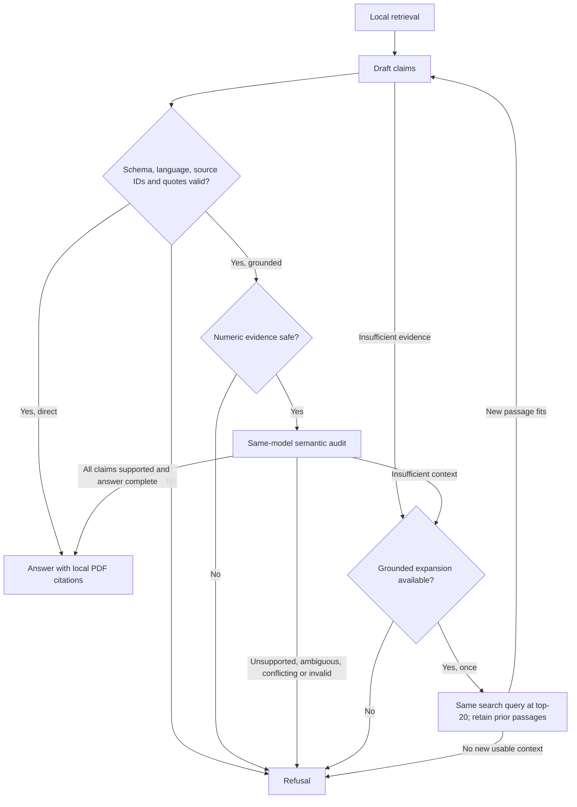
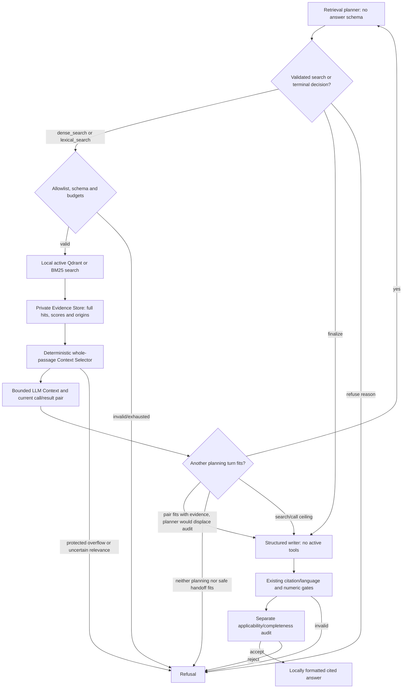

# Architecture and safety boundaries

GarageRAG separates local ingestion/retrieval from remote answer generation.
The implementation lives in [`src/garage_rag`](../src/garage_rag):

| Modules | Responsibility |
| --- | --- |
| `ingestion`, `embeddings`, `config`, `profiles` | Page extraction, token bounds and pinned model settings |
| `index`, `retrieval` | Persistent dense search; agentic/offline BM25, offline fusion and reranking |
| `generation`, `language`, `groq`, `planner` | Context, answer/planner schemas, language selection and provider transport |
| `workflow`, `agentic`, `agentic_context`, `agentic_budget`, `local_tools`, `grounding`, `telemetry` | Bounded LangGraph, evidence storage/selection, terminal token headroom, local numeric gate, audit and safe observations |
| `evaluation`, `optimization` | Frozen retrieval evaluation and profile comparisons |
| `answer_evaluation`, `source_evaluation`, `review_packet` | Paired answer evaluation and private hash-bound review |
| `cli` | `index`, `stats`, `search` and `ask` commands |
| `api` | Single-process FastAPI adapter for Direct/Grounded with sanitized public responses |

The React client lives in [`frontend`](../frontend). It calls the existing API
through a local Vite proxy; it holds no provider credentials or retrieval logic.
See [API configuration](usage.md#http-api) and [UI setup](usage.md#local-web-ui).

## Extraction and indexing

`pypdf` extracts every PDF page, including blank pages. Metadata retains filename,
content/document hashes, one-based PDF position, page label, title, source language,
vehicle models, document type and optional source URL. Citations always use physical
**PDF page N**, not a printed label. Extraction errors fail the document.

Cleanup normalizes Unicode/whitespace, removes control characters, conservative
alphabetic line-break hyphenation and repeated long margin lines. Chunking stays
within each page, prefers sentence/paragraph boundaries and uses tokenizer offsets.
Defaults are 384 tokens with up to 48 overlapping tokens, including prefix/special-token
allowance. Empty pages create no chunks; a wholly textless document fails indexing.
No OCR, geometry, figure or table reconstruction occurs. Chunk boundaries can split
procedures and qualifications.

Sentence Transformers loads revision-pinned models with remote code disabled.
E5 Small uses normalized 384-dimensional vectors and `query: ` / `passage: `
prefixes for every language. E5 Base uses 768 dimensions; BGE-M3 uses 1024-dimensional
dense vectors without E5 prefixes. All profiles retain the application's 512-token
input bound and separate indexes. See [profile configuration](usage.md#embedding-profiles).

Qdrant Local stores cosine vectors. Model/revision, prefixes, chunking and relevant
library versions form a configuration fingerprint. Document bytes and supplied
metadata determine revision identity; filenames must be unique within an index.
Deterministic point IDs reuse completed batches after interruption. An atomic
manifest replacement activates a revision only when every batch is written.
Search sees active revisions only; failed updates leave the last complete revision
available. Superseded/partial points remain private on disk; no compaction exists.

`Index.search` performs dense `query_points` retrieval. Scores are similarities,
not relevance probabilities. Qdrant Local permits one process per directory.
The offline comparison adapters add active-only BM25, deterministic reciprocal-rank
fusion and optional top-20 cross-encoder reranking without changing CLI search.

## Direct and grounded answers

Both modes use the original query, initial dense ranking, context builder,
generation prompt and local validator. Local Lingua detection selects EN/DE/RU;
explicit `--answer-language` overrides it. Evidence stays in the source language.

Context contains at most eight whole passages within a 12,000-character JSON
budget. Every source ID maps to exactly the text sent. Pydantic requires strict
JSON, at most six claims and evidence per claim. Local checks reject unknown IDs,
quotes absent after whitespace normalization, translated evidence, wrong-language
claims, bracketed references and truncated output. PDF citations come from local
metadata. Direct mode finishes after these checks, without semantic auditing.

Grounded mode applies a numeric gate and a separate completion auditing every
claim's entailment, applicability, essential conditions, numerical relationships,
conflicts and whole-question completeness. Unique, complete claim coverage and
all checks true are required. Malformed or inconsistent audits refuse; no repair
completion occurs. An auditor cannot override a failed local check.

Only a draft's `insufficient_evidence` or an audit's `insufficient` verdict can
trigger one expansion. It uses the same initial search query and score filter at top-20,
retains every previously sent passage and fills remaining space with novel passages.
Compact JSON omits display URLs and redundant page labels, while retaining full
passage text and applicability metadata. Local citation metadata is unchanged.
IDs are rebuilt for the new context. If nothing new fits, return `no_new_context`
without another completion. Initial `--top-k 20` disables expansion.

The graph is sequential typed state with conditional edges, a fresh instance per
command and no planner, query rewriting, tools, conversation memory, checkpointer
or remote graph service. Evaluation checkpoints are separate from graph state.

Production CLI/API Direct/Grounded entry points wrap these primitives in
`answering.run_answer` and `retrieval.AnswerSearch`. Original questions always
reach the writer/auditor. The adapter caches supported languages inferred locally
from active passage text, including mixed passages; metadata is not authoritative.
Substantive lines/sentences take precedence over short labels. If none can be
classified, the full chunk is the fallback. The cache keys on active generations.
These are hints, not guaranteed language labels or evidence filters.

When source hints include languages other than the detected question language,
`expand_queries` makes one metered Groq request for all missing languages (at most
two), preserving numbers, identifiers and the original question. Same-language,
unknown/empty corpora and ambiguous questions add no request. Malformed/truncated
translations stop without retry/fallback. `GARAGE_RAG_TRANSLATE_QUERY=false`
disables expansion; low-level callers without source hints retain original-only
behavior. Translation requests include only the question and target languages.

`Index.search_many` runs at most three queries in one active-filtered Qdrant batch.
Duplicate chunks retain maximum raw cosine score, with unchanged top-k, threshold
and context limits. One `search_calls` unit is one retrieval batch, not one vector;
Grounded's two rounds therefore allow at most six bounded vector queries. Recovery
reuses translations. The [matched BMW comparison](benchmarks/multilingual-ru-en.md)
records the original-only regression and the restored English-query results.
No source language fields, embedding profiles/prefixes, manifest fingerprints or
stored vectors change. Old indexes need no migration. Writers quote the actual
source language and write claims in the requested answer language. Agentic keeps
its existing autonomous search budget and uses observed source-language terms.

## Agentic retrieval (Phase 4A)

**Experimental:** `ask --workflow agentic` is a separate LangGraph; `direct`, `grounded`, their
prompts, limits and frozen evaluation datasets/metrics remain unchanged.

Groq uses `planner.Decision`: one strict JSON search/finalize/refuse decision,
with required nullable method/query/top_k/reason fields. Local validation rejects
incompatible or extra fields, unknown methods/reasons, blank queries and invalid
top-k. Planner history is ordinary assistant/user JSON, without provider tools.
The retained native tool protocol uses required serial search/finalize/refuse
actions; no protocol switch follows an error. Initial empty context is not evidence
of absence. Malformed decisions stop without repair/retry; finalize without sources
refuses without writer/audit calls. See [wire settings](providers.md#agentic-planner-transport).

`local_tools` owns the closed allowlist. `dense_search` delegates to active
`Index.search`; `lexical_search` reuses active-only BM25. Arguments are only a
nonblank 1–500-character query and integer top-k 1–5, further capped by CLI top-k.
Each action executes one search; finalize/refuse are local transitions with no
search or answer side effect. `--min-score` disables BM25 while retaining terminal
actions. No supplied paths, URLs, filters, executable names or remote tools run.
Batched/unknown calls, duplicate IDs and repeated normalized method/query/top-k
tuples stop before execution. There is no semantic paraphrase-repeat detector.

The writer gets fresh answer instructions, no active tools, and the latest valid
search/result correlation pair carrying all selected evidence. Groq's pair is
created locally after decision validation; it is not a provider-generated call.
Native call IDs round-trip unchanged. Earlier planner prompts/terminal actions
are omitted. Existing schema/language/quote/numeric validation and mandatory audit
still gate every positive answer. No search follows a failed audit.

### Agentic context management

`agentic_context` separates three objects. Direct/Grounded retain
`generation.build_context` at eight passages / 12,000 serialized characters.

1. **Evidence Store:** private full snapshots of query/method/top-k, raw hits,
   ranks/scores, original text/metadata/document IDs and every search/rank origin.
   Exact text plus all metadata identify duplicates; revisions/applicability stay
   distinct. Discovery-order S1…S20 IDs survive exclusion and re-entry. Four searches
   of at most five hits bound the store; captures include selection-rejected hits.
2. **Context Selector:** reselects from the whole store after each search. General
   request/document words and metadata vehicle qualifiers are excluded from focus.
   Compound topics require two focus terms within 160 characters; single-term
   topics require that term. Question and query anchors protect whole substantive
   passages, including conflicts. Without usable topic/navigation anchors, first
   semantic hits stay protected as unassessed; uncertain overflowing sets refuse.
3. **LLM Context:** at most twenty whole passages / 12,000 serialized characters.
   Protected material must fit together; otherwise `context_budget_exhausted`
   returns an empty selection before delivery. Optional relevant navigation fills
   spare capacity, deduplicated by revision and opaque target label. Priorities use
   question/query focus and reciprocal rank, never compare raw dense/BM25 scores.
   Membership is displayed in stable discovery order. No text is cut or summarized.

Conditions remain inside full passages or attach through retrieved same-page
procedure companions and explicit procedure_id/section_id/applies_to links within
a revision. No blanket adjacent-page protection exists. Bare conditional words
alone do not protect unrelated prose. Explicit warnings/applicability of unknown
scope, safety/layout metadata and uncertain extraction remain protected. Excluding
a warning by explicit scope requires complete primary-procedure scope in the same
revision; malformed/cross-revision/global metadata does not prove irrelevance.
These optional scope links are honored, not inferred by ingestion.

Structural reference lists are navigation, not answer evidence. Navigation-only
completion refuses before writing. `has_substantive_evidence=true` identifies
candidates, not sufficient, applicable or safe evidence. Off-topic prose is
excluded even if it fits. A store-only source cannot pass citation validation.

Only known bookkeeping is omitted on the wire: source_url, document_id,
content_sha256, chunk_index, char_start/char_end, tokens and a page_label equal to
pdf_page. Full originals remain in the store/local citation map for revision checks
and display. Applicability, safety, unknown metadata and passage text are retained.

History holds the question, latest correlation pair and bounded query/ID history,
replacing old source arrays. Model results carry compact roles/exclusions/counts
and the substantive-evidence flag. `new_sources` counts newly selected IDs.
Planner-only `navigation_hints` contain at most three exact headings, each at most
120 characters, source-bound and deduplicated within a revision. Long/unmatched
headings are skipped; labels never become physical PDF addresses. Both planner
prompts explain dense versus BM25 and suggest untried leads when only navigation/
safety is available. Choices/refusal remain autonomous; hints are untrusted data,
not forced routes or answer evidence. Decorating a copied message leaves writer/
auditor payloads unchanged. All updated inputs remain inside reservation checks.

Public `context_selections` contains counts/IDs, protection/exclusion reasons,
blocked IDs, sizes, roles, overlap/dependencies and a private-store hash.
`context_deliveries` records attempted source IDs/hash, phase, call and selection
only after reservation passes; a later provider/quota failure may still occur.
Full diagnostics stay in trace/captures. These public fields contain no questions,
source text, metadata, filenames or rewritten queries.

Lexical selection cannot prove complete warning scope or recover missing procedures/
continuations. It can miss paraphrases and unmarked cross-page conditions, or refuse
large unknown-scope warning sets. Same-model audit remains fallible. Verified scope
metadata/reference resolution would be separate work, not an existing guarantee.

### Token-aware terminal handoff

Hard ceilings: six attempted model calls including audit, four attempted searches,
twelve graph nodes, independent recursion limit sixteen. CLI can lower call/search
limits. Two call slots remain reserved for writer/audit; budgets below three calls
refuse before invoking a model. At a search/call ceiling, one search + writer +
audit takes three calls; a permitted early-finalize turn makes four. Four searches
plus writer/audit take six. Token/quota/step guards may stop earlier.

`--max-total-tokens` defaults to 24,000 (configurable 1–48,000), summing conservative
full message/history/schema/completion reservations including reasoning. Within a
question, reservations never refund failures or missing usage. Actual usage is
reported separately. Groq quota windows apply independently; there is no automatic
wait/retry/resume, reduced output, dropped source or provider substitution.

`agentic_budget` quotes the next planner, exact writer and audit base before extra
planning. Audit growth allocates the writer's entire completion allowance plus
UTF-8 bytes for the maximum draft JSON frame (six claims / four evidence items per
claim). The audit-sizing serializer is contract-tested against the unchanged real
auditor. This allocation is a capacity policy, not a universal JSON-size guarantee.

If writer + audit base/growth cannot fit remaining capacity, refuse before writing.
If the pair fits but another planner would displace it, hand substantive context
to writer/auditor; navigation-only context refuses. Otherwise planning stays
model-selected. Recompute after retrieval and before writing. Protect all capacity
remaining after the exact writer quote for audit; the validated normalized draft's
actual audit request must fit this allocation and the global cap. Spare capacity
may cover growth beyond the estimate; an oversized draft refuses without audit or
retry. An unaudited positive candidate is never returned.

Forecasts/protected headroom are not ledger debits: each actual attempt charges
once. `handoffs` records continue/handoff/refuse with costs/counts; `terminal_budget`
records terminal projection and audit capacity. Whole-graph tracing is disabled.
[Comparison results](benchmarks/phase4b-comparison.md) distinguish controlled offline
routes from live decisions, failures and separately reviewed answers.

## Budgets and failures

| Setting | Default / bound |
| --- | --- |
| Direct | One search batch, at most one answer completion |
| Cross-language expansion | At most one additional completion; none for same-language/unknown corpora |
| Grounded `--max-llm-calls` | 4, configurable 1–4 attempted completions including audits |
| Grounded `--max-searches` | 2, configurable 1–2 local searches |
| Graph recursion limit | 16, fixed safety net; normal longest path is seven nodes |
| Context | 8 chunks / 12,000 serialized characters, whole passages |
| Network-operation timeout | 60 seconds per request; no total call/workflow deadline |
| Groq completion/reasoning tokens | 2048 per call, configurable 512–4096 |

A draft reserves budget for its mandatory audit. A one-call grounded budget
therefore refuses without a completion. Normal acceptance uses two calls;
recovery after draft refusal uses at most three, after audit insufficiency at
most four. Direct mode ignores grounded budget flags. The default worst-case
answer-completion allowance is 8,192 Groq tokens across four calls; source-language
expansion can add 2,048 tokens in one request, for 10,240 across five calls.

Timeouts are HTTPX network-operation/inactivity limits, not whole-call deadlines;
keepalive traffic or local loading/search can extend wall time. Provider/local
errors stop safely (CLI exit 2); refusals are normal answers (exit 0). No retries,
automatic output repair, paid fallback or model switch occurs. See
[providers](providers.md) for transport controls and [usage](usage.md#generation-failures)
for terminal reasons.

## Numerical and semantic limits

Numeric claims require literal values in cited intact linguistic prose. Decimal
comma normalization is allowed; conversion, rounding and interpolation are not
inferred. Unit-adjacent literals such as `100Nm` count as numbers. Recognized
spelled-out EN/DE/RU cardinals are conservatively refused rather than converted.
This lexical detector is not an exhaustive grammar.

For numeric claims, sources with replacement characters, layout-required metadata,
suspicious numeric rows or orphaned cells are rejected. Wrapped dual-unit prose
can pass, but every number still needs a linguistic relationship. Nonnumeric claims
may proceed to auditing despite unrelated numbers elsewhere in the passage.
Chunk overlap or audit acceptance cannot override the gate. Some safe prose is
rejected; subtle table corruption can still escape detection. `requires_layout`
benchmark cases remain unsafe to answer from text alone.

The same model drafts and audits; it is not independent ground truth, and both
calls can share errors or follow embedded instructions. Sources and questions are untrusted input, and prompt instructions
are not proof of injection immunity. Quote containment does not establish entailment,
completeness or vehicle applicability. Top-20 retrieval cannot establish document-wide
absence or discover every conflict. The initial US-market E39 owner's manual is not
a workshop repair manual or evidence for all E39 variants. Inspect the original PDF
before acting. [Evaluation](benchmarks/grounded-answering.md) measures these boundaries
separately from software contracts.

## Observability and privacy

`ask --json` returns `supported`, `text`, `reason`, `language` and a `workflow` object
with counts/limits, durations, allowlisted node events and provider-reported token
usage. Incomplete usage is marked `token_usage_complete=false`; partial zero totals
are not zero-cost evidence. Provider errors retain only a validated HTTP status and
fixed category, never raw payloads. Traces omit questions, filenames, source text,
claims, quotes and keys; the answer itself can contain private quotations.

Groq receives the question, selected passages/metadata and audit
draft. Indexing/search stay local. LangSmith tracing is disabled around the whole
graph. Optional evaluation captures and review packets contain exact private
requests/replies and must stay outside Git. External retention/billing policies
remain provider-controlled.

Direct dependencies are pinned; there is no complete cross-platform transitive
lockfile, production concurrency or validated MPS runtime. Model revisions and
source/index hashes constrain reproducibility without promising identical future
live model behavior. See [testing](testing.md).
