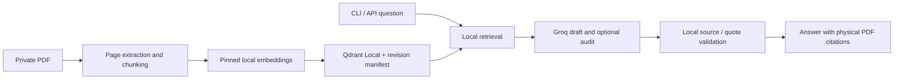
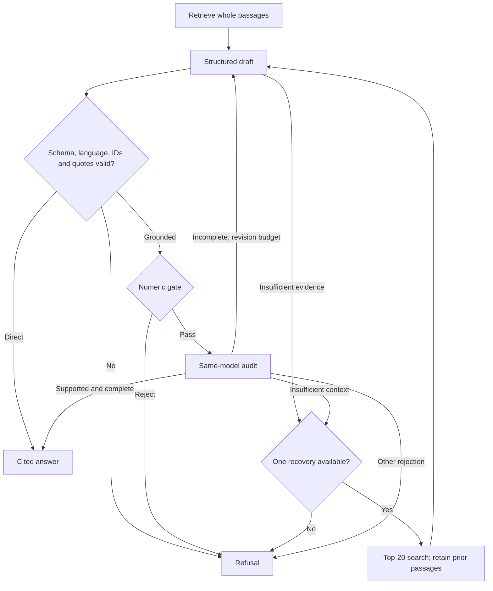

# Architecture

GarageRAG separates local PDF ingestion/retrieval from remote generation. The
CLI and FastAPI adapter share the same answer entry point; React displays API
results and has no provider credentials or retrieval logic.

## Code map

| Modules | Responsibility |
| --- | --- |
| `ingestion`, `embeddings`, `config`, `profiles` | Extraction, page-local chunking and pinned embedding profiles |
| `index`, `retrieval` | Persistent active-revision search, query batches, BM25 and bounded local reranking |
| `answering`, `language`, `generation`, `grounding` | Shared answer entry point, language/query preparation, evidence and numeric checks |
| `workflow` | Direct/Grounded routing, recovery and semantic audit |
| `agentic`, `planner`, `local_tools`, `agentic_context`, `agentic_budget` | Experimental planner, local search, context selection and terminal budgets |
| `groq`, `telemetry` | Provider transport, quota reservations and public observations |
| `evaluation`, `optimization` | Retrieval metrics and profile comparisons |
| `answer_evaluation`, `source_evaluation`, `review_packet` | Answer comparisons and private hash-bound review |
| `cli`, `api` | CLI commands and single-process HTTP/document adapters |

Python source is in [`src/garage_rag`](../src/garage_rag), the client in
[`frontend`](../frontend), and experiment inputs/scripts/results in
[`benchmarks`](../benchmarks/README.md).

## Extraction and indexing

`pypdf` extracts every physical page. Metadata retains filename, content/document
hashes, one-based PDF position, printed label and supplied applicability fields.
Citations use physical **PDF page N**, never infer a page from a printed label.
Cleanup normalizes Unicode/whitespace, control characters, conservative line-break
hyphenation and repeated long margins. Chunks stay within a page and prefer
sentence/paragraph boundaries; defaults are 384 tokens with up to 48 overlap.
Blank pages create no chunks; a wholly textless document fails. There is no OCR,
layout/table reconstruction or figure understanding.

Revision-pinned Sentence Transformers models load with remote code disabled.
E5 Small uses normalized 384-dimensional vectors and `query: ` / `passage: `
prefixes; E5 Base uses 768 dimensions, BGE-M3 1024 without E5 prefixes. Profiles
retain a 512-token input bound and require separate compatible indexes.

Qdrant Local stores cosine vectors. A configuration fingerprint binds model,
revision, prefixes, chunking and relevant library versions. PDF bytes and supplied
metadata determine a document revision; filenames identify documents within an
index. Deterministic point IDs let identical interrupted batches resume. Atomic
manifest replacement activates a revision only after all batches complete.
Search sees active revisions; failed updates preserve the last complete version.
Superseded/partial points remain on disk; there is no deletion or compaction.
One process may own each index directory.

## Query preparation and retrieval

Local Lingua heuristics detect EN/DE/RU. An answer-language override controls
claims, independently of query preparation. Original questions reach the writer
and auditor; quotations remain in their actual source language.

`answering.run_answer` uses `retrieval.AnswerSearch`. Source-language hints are
inferred from active text, including mixed passages, and cached by active generation;
metadata is not authoritative. If hints include another language, one Groq request
adds all missing source-language queries, at most two. Numbers/identifiers are
validated; malformed translations stop without retry. Same-language, ambiguous
or unknown/empty-corpus paths add no request. `GARAGE_RAG_TRANSLATE_QUERY=false`
uses only the original. Translation receives the question, not PDF passages.

`Index.search_many` batches at most three dense queries with active filtering.
Duplicates retain maximum raw cosine. Expanded mixed-language search reserves
each query's first five hits, fills a maximum 20-candidate pool, and reranks with
the pinned local mMARCO MiniLM cross-encoder. Intact passages use prepared questions
in observed languages; uncertain passages use available source-language questions.
At most 60 pairs fit the existing 512-token pair limit. Oversized pairs retain
dense order; invalid scores or ranking failures stop retrieval. Model loading is
lazy. Monolingual/original-only paths retain dense order without the extra model.
Raw cosine/min-score eligibility is preserved; scores are not probabilities.

One search count means one batch, not one vector. Grounded recovery reuses the
prepared queries. CLI `search` remains dense; BM25 is available to Agentic and
offline comparison, with term statistics built lazily. See the
[multilingual measurements](../benchmarks/reports/multilingual.md) for recall,
top-one losses and CPU/memory cost.

## Direct and Grounded

Context contains up to eight whole passages within 12,000 serialized characters.
Source IDs bind exactly the text sent. Strict JSON allows up to six claims and
four evidence entries each. Writers must provide a source ID and verbatim quote;
a source ID alone cannot substitute the whole passage. Local validation rejects
unknown IDs, quotes absent after whitespace normalization, translated quotations,
wrong-language claims and truncated output. PDF metadata supplies citations;
there is no font-specific quote repair or local rewriting of claim text.

Direct returns locally valid output without semantic audit. Grounded also checks
numerical evidence and requires a separate audit of every claim's entailment,
applicability, essential conditions, conflicts and whole-question completeness.
An incomplete draft may be revised once against the same context when another
draft/audit pair fits. Malformed audits refuse; an audit cannot override local
checks. Only an insufficient-evidence draft or insufficient-context audit can
trigger one top-20 recovery, preserving all prior passages and applicability.
No new fitting passage returns `no_new_context` without another completion.

Numeric claims require literal values in intact prose. Decimal commas and wrapped
dual units are recognized; conversion/interpolation, damaged tables and layout
relationships are not inferred. Spelled-out counts are conservatively rejected.
Unrelated table rows do not invalidate otherwise intact numbered prose, but a
valid procedure quote cannot establish nearby table values. These heuristics can
both over-refuse safe prose and miss corruption. Same-model audit is fallible.

## Agentic retrieval

`ask --workflow agentic` runs a separate experimental graph. The Groq planner
emits strict search/finalize/refuse JSON; `planner` validates fields and
`local_tools` dispatches only dense or active-only BM25 search. Search arguments
are a nonblank query of at most 500 characters and top-k 1–5. `--min-score`
disables BM25. Unknown/batched actions and exact repeated searches stop locally.
No planner-provided file path, URL or executable runs. The retained native-tool
protocol is separate; neither protocol is an error fallback.

### Context management

The private evidence store retains full hits, metadata and every search origin,
with stable discovery IDs. Selection reconsiders whole passages after each search;
question/query anchors, applicability, safety and uncertain scope protect relevant
material. Optional navigation fills spare capacity. Protected overflow or uncertain
relevance refuses instead of trimming text. The model receives at most 20 whole
passages / 12,000 serialized characters, with compact history and bounded exact
navigation headings. Navigation-only evidence cannot produce an answer.

Explicit same-revision procedure/scope links are honored, not inferred by ingestion.
Lexical selection can miss paraphrases and unmarked cross-page conditions. No
blanket adjacent-page guarantee exists. Excluded sources remain in private captures
but cannot pass citation validation if they were not sent to the writer.

### Terminal budgets

Defaults are six attempted model calls, four searches, twelve graph steps and
24,000 held tokens; the recursion limit is 16. Two call slots and conservative
terminal token headroom are reserved for writer/auditor. If another planner would
displace an affordable terminal pair, substantive evidence is handed off; if the
pair cannot fit, the graph refuses. The actual audit request is checked again
against remaining capacity. Reservations are charged once per attempt and never
refund failures/missing usage. A positive answer always passes the writer's local
checks, numeric gate and mandatory audit. No search follows a rejected audit.

[Evaluation](../benchmarks/reports/answering.md) separates these enforced contracts
from unsuccessful live trials; no Agentic quality/resource advantage is established.

## Budgets and adapters

| Bound | Default |
| --- | --- |
| Direct | One retrieval batch and one answer completion |
| Grounded | At most four answer/audit attempts and two retrieval batches |
| Source-language expansion | At most one additional completion, reused on recovery |
| Direct/Grounded context | Eight whole passages / 12,000 serialized characters |
| Groq completion including reasoning | 2048 tokens, configurable 512–4096 |
| HTTP timeout | 60 seconds per network operation; no total workflow deadline |

FastAPI reuses the CLI answer path, adding structured claims and hash-bound PDF
citations. One process owns the index/client; uploads and answers share a
non-queuing exclusive lock. Originals live in a private upload store and are served
only when name/hash match an active revision and verified bytes. React renders
claims/evidence and a local PDF viewer. See [HTTP API](usage.md#http-api) for
response fields, status codes, storage and local-server constraints.

## Privacy and interpretation

Indexing/search stay local. Groq receives questions, selected source passages and
audit drafts; provider retention is external. LangSmith tracing is disabled around
the graph. Public observations contain counts, IDs, durations and sanitized failure
categories, not questions/source text/keys. Answers and private review captures can
contain copyrighted or sensitive text and must stay out of Git.

Local quote validity proves provenance, not truth, completeness or vehicle
applicability. Sources/questions are untrusted; prompt instructions do not prove
injection immunity. Retrieval cannot establish document-wide absence. There is no
independent human/vehicle acceptance, production concurrency or validated MPS
runtime. Direct dependencies and model revisions are pinned; the Python transitive
environment is not completely locked across platforms. See [testing](testing.md).
