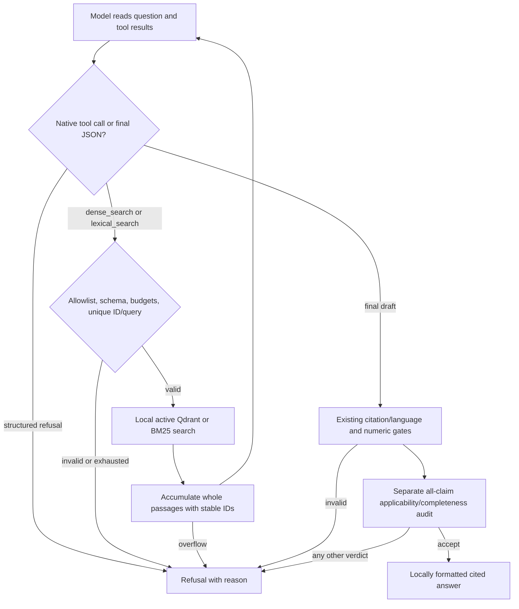

# Architecture and safety boundaries

GarageRAG separates local ingestion/retrieval from remote answer generation.
The implementation lives in [`src/garage_rag`](../src/garage_rag):

| Modules | Responsibility |
| --- | --- |
| `ingestion`, `embeddings`, `config`, `profiles` | Page extraction, token bounds and pinned model settings |
| `index`, `retrieval` | Persistent dense search; experiment-only BM25, fusion and reranking |
| `generation`, `language`, `groq` | Context, schemas, language selection and provider transport |
| `workflow`, `agentic`, `local_tools`, `grounding`, `telemetry` | Bounded LangGraph, local numeric gate, audit and safe observations |
| `evaluation`, `optimization` | Frozen retrieval evaluation and profile comparisons |
| `answer_evaluation`, `source_evaluation`, `review_packet` | Paired answer evaluation and private hash-bound review |
| `cli` | `index`, `stats`, `search` and `ask` commands |

## Extraction and indexing

`pypdf` extracts every PDF page, including blank pages. Metadata retains filename,
content/document hashes, one-based PDF position, page label, title, source language,
vehicle models, document type and optional source URL. Citations always use physical
**PDF page N**, not a printed label. Extraction errors fail the document.

Cleanup normalizes Unicode/whitespace, removes control characters, conservative
alphabetic line-break hyphenation and repeated long margin lines. Chunking stays
within each page, prefers sentence/paragraph boundaries and uses tokenizer offsets.
Defaults are 384 tokens with up to 48 overlapping tokens, including prefix/special-token
allowance. Empty pages create no chunks; a wholly textless document fails indexing.
No OCR, geometry, figure or table reconstruction occurs. Chunk boundaries can split
procedures and qualifications.

Sentence Transformers loads revision-pinned models with remote code disabled.
E5 Small uses normalized 384-dimensional vectors and `query: ` / `passage: `
prefixes for every language. E5 Base uses 768 dimensions; BGE-M3 uses 1024-dimensional
dense vectors without E5 prefixes. All profiles retain the application's 512-token
input bound and separate indexes. See [profile configuration](usage.md#embedding-profiles).

Qdrant Local stores cosine vectors. Model/revision, prefixes, chunking and relevant
library versions form a configuration fingerprint. Document bytes and supplied
metadata determine revision identity; filenames must be unique within an index.
Deterministic point IDs reuse completed batches after interruption. An atomic
manifest replacement activates a revision only when every batch is written.
Search sees active revisions only; failed updates leave the last complete revision
available. Superseded/partial points remain private on disk; no compaction exists.

`Index.search` performs dense `query_points` retrieval. Scores are similarities,
not relevance probabilities. Qdrant Local permits one process per directory.
The offline comparison adapters add active-only BM25, deterministic reciprocal-rank
fusion and optional top-20 cross-encoder reranking without changing CLI search.

## Direct and grounded answers

Both modes use the original query, initial dense ranking, context builder,
generation prompt and local validator. Local Lingua detection selects EN/DE/RU;
explicit `--answer-language` overrides it. Evidence stays in the source language.

Context contains at most eight whole passages within a 12,000-character JSON
budget. Every source ID maps to exactly the text sent. Pydantic requires strict
JSON, at most six claims and evidence per claim. Local checks reject unknown IDs,
quotes absent after whitespace normalization, translated evidence, wrong-language
claims, bracketed references and truncated output. PDF citations come from local
metadata. Direct mode finishes after these checks, without semantic auditing.

Grounded mode applies a numeric gate and a separate completion auditing every
claim's entailment, applicability, essential conditions, numerical relationships,
conflicts and whole-question completeness. Unique, complete claim coverage and
all checks true are required. Malformed or inconsistent audits refuse; no repair
completion occurs. An auditor cannot override a failed local check.

Only a draft's `insufficient_evidence` or an audit's `insufficient` verdict can
trigger one expansion. It uses the unchanged question and score filter at top-20,
retains every previously sent passage and fills remaining space with novel passages.
Compact JSON omits display URLs and redundant page labels, while retaining full
passage text and applicability metadata. Local citation metadata is unchanged.
IDs are rebuilt for the new context. If nothing new fits, return `no_new_context`
without another completion. Initial `--top-k 20` disables expansion.

The graph is sequential typed state with conditional edges, a fresh instance per
command and no planner, query rewriting, tools, conversation memory, checkpointer
or remote graph service. Evaluation checkpoints are separate from graph state.

## Agentic retrieval (Phase 4A)

`ask --workflow agentic` is a separate LangGraph; `direct`, `grounded`, their
prompts, limits and frozen evaluation datasets/metrics remain unchanged.

The model chooses both the retrieval tool and the query; there is no prescribed
search order, translation dictionary or fixed top-k expansion. Results can prompt
English reformulation of DE/RU input, clarification, another topic or comparison
across documents. `stop_reason` can distinguish insufficient evidence, ambiguity,
conflicting sources and out-of-scope requests. These are model decisions, not
proof of entailment or document-wide absence. No additional search follows a
failed final audit; this version reserves one audit and refuses on rejection.

`local_tools` defines the closed function schemas: `dense_search` and
`lexical_search`, each taking only a 1–500-character nonblank query and integer
`top_k` 1–5. The CLI's `--top-k` further caps each call. Dense delegates to
`Index.search`; BM25 reuses `Retriever` over active Qdrant generations. Each tool
executes exactly one search. With `--min-score`, only dense is exposed so the
cosine threshold cannot be silently discarded. No model-supplied filters, paths,
URLs, executable names, function registries or remote tools are accepted.

Tool call IDs and results round-trip through native assistant/tool messages;
malformed/unknown/batched calls, duplicate IDs and repeated tool/query/top-k tuples
stop before execution. Search results return all accumulated whole evidence with
stable `S1…S20` IDs. Deduplication uses document/page/text. The serialized source
budget remains 12,000 characters; unlike baseline context packing, overflowing
any accumulated evidence refuses rather than dropping a warning or conflict.
Earlier tool messages also remain in the bounded history. At most 20 passages can
be returned by four searches of five hits; tool and transcript overhead consumes
the separate token budget. There is no checkpoint, persistent agent memory or
agent-controlled filesystem mutation.

Hard ceilings are six LLM attempts (including the final audit), four attempted
searches and twelve executed graph nodes; a recursion limit of sixteen is an
independent safety net. `--max-llm-calls`/`--max-searches` can lower these limits.
One LLM call is kept for the audit, leaving at most five planning/finalization
turns. A no-search refusal can take one call; a supported one-search answer takes
three; four searches plus finalization and audit take six. A lower call cap can
leave no room to finalize. No unaudited supported answer is emitted.

`--max-total-tokens` defaults to 24,000, accepts 1–48,000 and bounds the sum of
conservative request reservations: full input/history, tool schemas and the full
per-call completion allowance including reasoning. Reservations are never refunded
within a question, even for failed calls or missing usage. Observed usage remains
separately reported. A request that cannot fit is stopped before invocation; no
implicit smaller output, removed source or substitute provider is used. The default
token budget can stop earlier than the six-call ceiling. Groq additionally checks
all four rate windows before every request; normal usage may hit 8,000 TPM well
before the question's total cap. There is no automatic wait/retry/resume.

Agentic traces add token budget/reservations and step counts to the existing safe
telemetry, without exposing rewritten queries, tool arguments, source text or
reasoning. The whole graph and tool/model operations suppress inherited LangSmith
tracing. The selected LLM still receives the question and retrieved evidence.

Offline acceptance exercises real LangGraph and local Qdrant/BM25 plus controlled
policy/model/HTTP fixtures. The same evidence-sensitive policy takes different
routes for an empty hit set, a cross-reference and sufficient evidence. This
proves that orchestration supports adaptive choices; it does not show that the
live Groq model will choose good searches or improve the frozen grounded metrics.

## Budgets and failures

| Setting | Default / bound |
| --- | --- |
| Direct | One search, at most one completion |
| Grounded `--max-llm-calls` | 4, configurable 1–4 attempted completions including audits |
| Grounded `--max-searches` | 2, configurable 1–2 local searches |
| Graph recursion limit | 16, fixed safety net; normal longest path is seven nodes |
| Context | 8 chunks / 12,000 serialized characters, whole passages |
| Network-operation timeout | 60 seconds per request; no total call/workflow deadline |
| OpenRouter completion/reasoning tokens | 8192 per call, configurable 512–32768 |
| Groq completion/reasoning tokens | 2048 per call, configurable 512–4096 |

A draft reserves budget for its mandatory audit. A one-call grounded budget
therefore refuses without a completion. Normal acceptance uses two calls;
recovery after draft refusal uses at most three, after audit insufficiency at
most four. Direct mode ignores grounded budget flags. The default worst-case
completion allowance is 32,768 OpenRouter or 8,192 Groq tokens across four calls.

Timeouts are HTTPX network-operation/inactivity limits, not whole-call deadlines;
keepalive traffic or local loading/search can extend wall time. Provider/local
errors stop safely (CLI exit 2); refusals are normal answers (exit 0). No retries,
automatic output repair, paid fallback or model switch occurs. See
[providers](providers.md) for transport controls and [usage](usage.md#generation-failures)
for terminal reasons.

## Numerical and semantic limits

Numeric claims require literal values in cited intact linguistic prose. Decimal
comma normalization is allowed; conversion, rounding and interpolation are not
inferred. Unit-adjacent literals such as `100Nm` count as numbers. Recognized
spelled-out EN/DE/RU cardinals are conservatively refused rather than converted.
This lexical detector is not an exhaustive grammar.

For numeric claims, sources with replacement characters, layout-required metadata,
suspicious numeric rows or orphaned cells are rejected. Wrapped dual-unit prose
can pass, but every number still needs a linguistic relationship. Nonnumeric claims
may proceed to auditing despite unrelated numbers elsewhere in the passage.
Chunk overlap or audit acceptance cannot override the gate. Some safe prose is
rejected; subtle table corruption can still escape detection. `requires_layout`
benchmark cases remain unsafe to answer from text alone.

The same model drafts and audits; both calls can share errors or follow embedded
instructions. Sources and questions are untrusted input, and prompt instructions
are not proof of injection immunity. Quote containment does not establish entailment,
completeness or vehicle applicability. Top-20 retrieval cannot establish document-wide
absence or discover every conflict. The initial US-market E39 owner's manual is not
a workshop repair manual or evidence for all E39 variants. Inspect the original PDF
before acting. [Evaluation](benchmarks/grounded-answering.md) measures these boundaries
separately from software contracts.

## Observability and privacy

`ask --json` returns `supported`, `text`, `reason`, `language` and a `workflow` object
with counts/limits, durations, allowlisted node events and provider-reported token
usage. Incomplete usage is marked `token_usage_complete=false`; partial zero totals
are not zero-cost evidence. Provider errors retain only a validated HTTP status and
fixed category, never raw payloads. Traces omit questions, filenames, source text,
claims, quotes and keys; the answer itself can contain private quotations.

The selected provider receives the question, selected passages/metadata and audit
draft. Indexing/search stay local. LangSmith tracing is disabled around the whole
graph. Optional evaluation captures and review packets contain exact private
requests/replies and must stay outside Git. External retention/billing policies
remain provider-controlled.

Direct dependencies are pinned; there is no complete cross-platform transitive
lockfile, production concurrency or validated MPS runtime. Model revisions and
source/index hashes constrain reproducibility without promising identical future
live model behavior. See [testing](testing.md).
