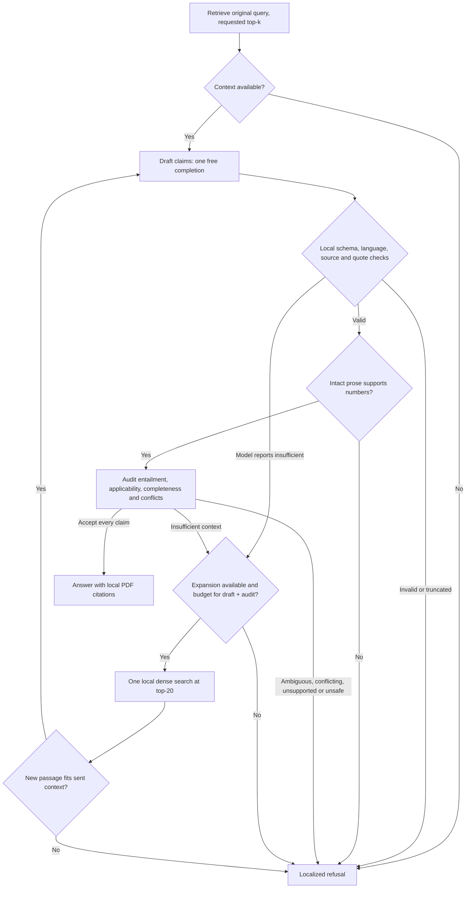

# Bounded grounded answering (Phase 3)

`ask` uses a LangGraph workflow by default. `ask --workflow direct` preserves
Phase 2's single `retrieve -> generate` baseline. Both use the same initial
query, dense ranking, context builder, generation prompt and local validator.
Indexing, `search`, embedding profiles and the frozen retrieval experiments
are unchanged. No model, agent or translation service participates in search.

## State and routing

The typed state contains the bounded source map, validated candidate, routing
reason, terminal answer and sanitized error. Nothing is checkpointed or persisted.
Each command creates a fresh graph; there is no conversation memory. Retrieval
and generation are explicit nodes, not autonomous tools. The graph uses
[StateGraph conditional edges](https://docs.langchain.com/oss/python/langgraph/graph-api).
No LLM planner, query rewriting, automatic repair, parallel completions or
external search is added.

The first search respects `--top-k` and `--min-score`. Only a generator's
`insufficient_evidence` or an auditor's `insufficient` can expand. Expansion
uses the **unchanged original question and filters** at top-20 in the same
active index. Every previously sent passage is retained first, including warnings and
conflicts, and novel passages use the remaining context budget. Expansion
refuses when no new passage fits alongside all prior evidence. Source IDs are
rebuilt and the draft must cite the resulting map. A returned chunk that cannot fit the
12,000-character serialized context budget is not new usable evidence. No
novel sent passage means `no_new_context`, without another completion. If the
initial top-k is already 20, expansion is disabled.

This bounded depth increase can recover facts below the first five ranks.
It cannot fix an embedding-language miss outside the first twenty, reconstruct
a table, guarantee broad contradiction discovery, or distinguish document-wide
absence from a retrieval miss. There is no similarity-score sufficiency
threshold: raw E5 and BGE scores are not calibrated answer probabilities.

## Budgets and failures

| Setting | Default | Allowed |
| --- | ---: | --- |
| `ask --max-llm-calls` | 4 | 1–4 attempted completions, including audits |
| `ask --max-searches` | 2 | 1–2 local searches |
| Graph recursion limit | 16 | Fixed safety net |
| Context per request | 8 chunks / 12,000 characters | Fixed maximum, whole passages only |
| Network-operation timeout | 60 seconds | Same SDK/HTTPX client as direct mode |
| Completion tokens per request | 8192 | Existing `OPENROUTER_MAX_TOKENS`, 512–32768 |

An ordinary accepted answer uses one draft and one audit. Recovery after a
model refusal uses at most three completions; recovery after an audit uses at
most four. A draft starts only if there is budget for its mandatory audit.
A budget of one therefore refuses without making an unauditable completion.
These are upper bounds, not a promise to spend the full budget. Direct mode
always has its original one-completion/one-search bound; grounded budget flags
do not change it.

The default worst case allows 32,768 completion/reasoning tokens over four
separate calls; raising the per-request environment budget raises that bound.
The 60-second SDK setting is an [HTTPX network-operation/inactivity
timeout](https://www.python-httpx.org/advanced/timeouts/), not a total completion
deadline. A live failed request took about 120 seconds; continued data/keepalive
traffic can extend a call. There is no hard wall-clock deadline for a completion,
the whole command, or local model loading/search. Request and graph-step counts
are bounded independently. Interrupt an unresponsive command rather than assuming
it will finish within four minutes.
The graph's normal longest path is seven nodes; monotonic search and completion
counters prevent repeated expansion. The recursion limit is an additional
fail-closed safeguard, not the primary stopping mechanism.

SDK retries, application retries and paid provider fallbacks remain disabled.
All calls use the same `make_llm` client, `:free`/free-router allowlist and zero
prompt/completion/request price caps. No paid fallback occurs on rate limits,
timeouts, truncation, malformed output or invalid citations. Provider errors
stop immediately and produce a sanitized CLI error (exit 2). Local retrieval
errors and graph failures also stop without displaying source state or provider
payloads. A refusal is a normal localized answer (exit 0); it is not an API error.

## Evidence boundaries

Local Pydantic schema checks, language detection, source-ID lookup and verbatim
quote containment are shared with direct mode. The original `answer()` function
retains its return contract. Page references come only from local metadata.
Unknown IDs, invented/translated evidence, wrong-language claims, bracketed
references and truncated output cannot reach the semantic auditor as valid
claims. No audit can override a failed local check.

A separate completion audits every claim exactly once against its quotes,
full passages and all other sent passages. It checks entailment, applicability,
numeric relationships, contradictory evidence and whole-question completeness.
The JSON verdict contains only enumerated decisions and boolean checks; no
free-form justification is exposed as an answer. Acceptance requires complete
coverage, unique indices and all checks true. Inconsistent, malformed or
truncated reviews refuse; they are not repaired.

This auditor uses the **same selected model** in a separate prompt. It is not
independent human verification, nor a calibrated entailment classifier. Both
calls can share the same misunderstanding or follow an injection. The evaluator
never uses this verdict as its factual ground truth. Known adversarial fixtures
include an auditor falsely accepting an invalid inference and falsely rejecting
a correct claim, making these limitations executable rather than implicit.

### Numerical and table policy

Existing extraction does not reconstruct PDF geometry. The workflow permits a
numeric claim only when each literal value appears in cited, intact prose with
an explicit linguistic relationship; decimal comma normalization is allowed,
but conversion, interpolation and rounding are not inferred. Unit-adjacent
literals such as `100Nm` are still numbers; recognized spelled-out cardinals in
EN/DE/RU are conservatively refused instead of converted. This lexical detector
is not an exhaustive grammar of numerical language. The semantic
auditor must additionally verify the quantity, conditions and variant.

Cited sources with replacement characters, layout-required metadata, repeated
numeric rows or orphaned numeric cells are rejected conservatively. This also
blocks values expressed as words. An audit verdict or duplicate/overlapping
chunk cannot override the local gate. There is no facility to certify a
reconstructed table in this phase. Valid numeric prose can still be rejected
because a chunk also contains a table, because extraction splits a sentence,
or because the heuristic does not recognize its phrasing. Such cases count as
false refusals where the evaluation labels establish answerability.

The heuristics cannot recognize every flattened or subtly corrupted table.
An undetected table and a mistaken auditor can still produce an incorrect
interpretation. A numeric answer is not vehicle validation; inspect the original
PDF and applicability before using it. Existing benchmarks with `requires_layout`
are explicitly treated as unsafe to answer from text alone, without editing
their original retrieval labels.

## Local observability and privacy

The original JSON fields `supported`, `text`, `reason` and `language` remain.
An additive `workflow` object reports mode, attempt/search counts and limits,
wall-clock duration, allowlisted node/outcome/timing/source-count events, and
provider-reported input/output tokens. `token_usage_complete=false` means some
usage was unavailable; zero partial totals must not be described as zero cost.
Reported provider tokens are not an independent billing or reasoning-token audit.
`provider_errors` records only a validated HTTP status (or null) and a fixed
HTTP/timeout/transport/unknown category. Missing status is not inferred from the
generic user-facing error. Earlier captures lack this field and cannot be
retrospectively diagnosed as a specific HTTP failure.

Observations contain no question, filenames, source text, claims, quotes, API
keys or raw errors. Private context and drafts remain process-local. LangSmith
tracing is disabled around the entire graph, not only the model invocation;
no checkpointer, LangGraph service or external tracing backend is configured.
Index/search remain local; `ask` sends question, selected passages and candidate
claims to OpenRouter/providers for drafting and auditing. Generated answers and
optional evaluation captures themselves contain private quotes: protect them.

Common terminal reasons include `no_context`, `insufficient_evidence`,
`no_new_context`, `invalid_model_output`, `invalid_audit_output`,
`output_token_limit`, `llm_budget_exhausted`, `unsupported_claims`,
`ambiguous_question`, `conflicting_sources`, `unsafe_numeric_evidence` and
`out_of_scope`. Errors add `generation_error`, `retrieval_error`, `step_limit`
or `workflow_error`. A refusal describes the supplied/retrieved evidence,
not certainty that the documentation contains no answer.

See [answer evaluation](benchmarks/grounded-answering.md) for reproduction,
measured tradeoffs, and the separate retrieval/claim-quality denominators.
